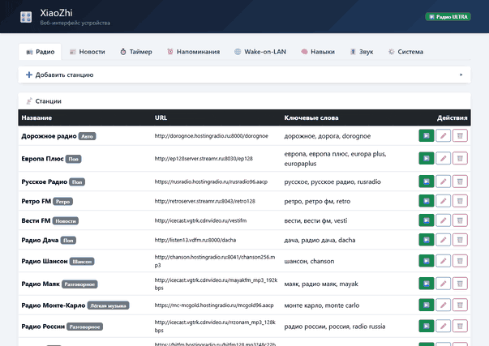
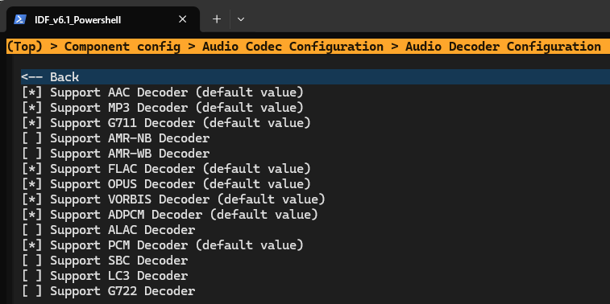

### Прошивка протестирована на Seeed Studio XIAO ESP32-S3 Plus (8 MB PSRAM, 16 MB Flash) с OLED-дисплеем 128×32.

  

Что сделано:

- **Радио**: настраиваемый список станций в веб-интерфейсе. Порядок поиска станции голосом: ключевые слова, затем название, затем жанр. Если сказать только жанр, включается случайная радиостанция из всех доступных в этом жанре.
- **Новости (RSS)**: настраиваемый список лент в веб-интерфейсе. Порядок поиска ленты голосом: ключевые слова, затем название, затем категория. Если сказать только категорию, выбирается случайная лента из всех доступных в этой категории.
- **Таймер**: до 24 часов. Голосом можно установить таймер, отменить его и узнать оставшееся время. Остаток отображается на экране, по завершении звучит оповещение.
- **Напоминания**: установка напоминаний. Уведомит звуковым оповещением и текстом на экране.
- **Wake-on-LAN**: включается голосом по имени компьютера. Без имени - компьютер по умолчанию.
- **Анекдоты**: случайный анекдот с сайта rzhunemogu.ru.
- **Курс и конвертер валют**: данные ЦБ РФ, около 50 валют.
- **Эквалайзер**: 8 полос, усиление от −15 до +15 дБ.
- **Навыки**: галочки на вкладке - отмеченные навыки не завершают разговор, после их выполнения можно сразу задать следующий вопрос.
- **Веб-интерфейс**: импорт и экспорт JSON для всех списков, отображение статуса устройства и хранилища. Доступен по адресу `http://IP_УСТРОЙСТВА`.
- **Поиск в интернете**: 🚧 ведётся работа над реализацией.

> 🔧 **В процессе исправления:**
> - ~~Заедание голосового ассистента при воспроизведении интернет-радио.~~ Фикс добавлен, нужно протестировать.
> - ~~При вызове голосового ассистента во время работы интернет-радио радиостанция перестаёт играть.~~ Фикс добавлен, нужно протестировать.

**ВАЖНО!** Требуется флешка минимум на 16 МБ. Сейчас свободно ~47 КБ. В таблицу разделов добавлен раздел `storage` размером 128 КБ. В нём хранятся списки. Раздел добавлен за счёт уменьшения размера `assets`. Если объём Flash вашего микроконтроллера больше 16 МБ, посмотрите [пример таблицы разделов для 16 МБ](partitions/v2/16m.csv) и внесите необходимые изменения.

Если нужно место под реализацию дополнительных функций

Можно получить около 190 КБ, отключив ненужные кодеки в menuconfig:

 

**Демонстрационные списки:**
- [Радио](docs/mod/radio-stations.json)
- [Новости](docs/mod/rss-feeds.json)

 ### [Оригинальный README проекта](https://github.com/78/xiaozhi-esp32#an-mcp-based-chatbot)