# Настройка поиска в интернете
Для работы поиска используется связка **Tavily** и **Google Apps Script**.

Настройка займёт около 10 минут. Потребуется аккаунт Google и регистрация в Tavily.

Бесплатный тариф Tavily предусматривает ограниченное количество запросов в месяц (1000).

- Зарегистрируйтесь на [Tavily](https://app.tavily.com/). Необходимо некоторое средство обхода ограничений 😉
- В личном кабинете найдите и скопируйте API ключ, он понадобится далее:

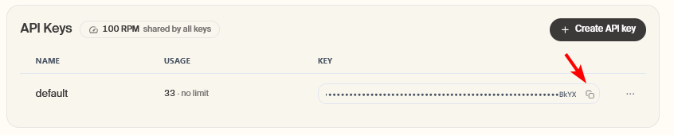
- Перейдите в [Apps Script](https://script.google.com/)
- Нажмите "Создать проект":

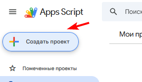
- Вставьте код целиком:

<details>
<summary>Нажмите, чтобы развернуть код</summary>

```javascript
/**
 * Поисковый прокси для голосового ассистента (XiaoZhi) на Google Apps Script.
 * Принимает GET/POST, ходит в Tavily с серверов Google (обход гео-блока),
 * отдаёт компактный JSON: answer + до N результатов (t/u/s).
 *
 * Параметры запроса:
 *   token   — обязателен, сверяется с TOKEN из свойств скрипта
 *   q       — запрос (до 200 символов)
 *   lang    — язык выдачи, по умолчанию ru
 *   topic   — general | news
 *   n       — 1..10, по умолчанию 3
 *   strict  — 1: строго фильтровать выдачу по языку
 *   answer  — 0: не просить у Tavily готовый ответ
 *   adv     — 1: include_answer: 'advanced' (подробнее и длиннее)
 *   only    — 1: вернуть ТОЛЬКО answer простым текстом, без JSON
 *   debug   — 1: показать тело ошибки upstream
 *
 * Свойства скрипта (Настройки проекта -> Свойства скрипта):
 *   TOKEN        — длинная случайная строка, обязательна
 *   TAVILY_KEY   — ключ tvly-..., обязателен
 *   DEFAULT_LANG — необязательно, по умолчанию "ru"
 */

var CACHE_TTL_SEC = 600;

function doGet(e) {
  return handle((e && e.parameter) || {});
}

function doPost(e) {
  var p = (e && e.parameter) || {};
  if (e && e.postData && e.postData.contents && e.postData.type &&
      e.postData.type.indexOf('json') >= 0) {
    try {
      var body = JSON.parse(e.postData.contents);
      for (var k in body) p[k] = body[k];
    } catch (err) { /* останутся параметры из URL/формы */ }
  }
  return handle(p);
}

function handle(p) {
  var props = PropertiesService.getScriptProperties();
  // only=1 — отдать только answer простым текстом (ни JSON, ни результатов)
  var only = String(p.only || '0') === '1';

  if (String(p.token || '') !== String(props.getProperty('TOKEN') || '')) {
    return fail('forbidden', only);
  }

  var q = String(p.q || '').replace(/\s+/g, ' ').trim().slice(0, 200);
  if (!q) return fail('empty query', only);

  var lang = String(p.lang || props.getProperty('DEFAULT_LANG') || 'ru')
    .toLowerCase().slice(0, 5);
  var topic = (String(p.topic || 'general').toLowerCase() === 'news') ? 'news' : 'general';
  var strict = String(p.strict || '0') === '1';
  var wantAnswer = String(p.answer || '1') !== '0';
  var advanced = String(p.adv || '0') === '1';   // include_answer: 'advanced' — подробнее
  var n = parseInt(p.n, 10);
  if (!(n >= 1 && n <= 10)) n = 3;

  var cache = CacheService.getScriptCache();
  var cacheKey = 'q' + Utilities.base64EncodeWebSafe(Utilities.computeDigest(
    Utilities.DigestAlgorithm.MD5,
    [q, lang, topic, strict ? 's' : '-', wantAnswer ? 'a' : '-', advanced ? 'v' : '-', n].join('|')));
  var hit = cache.get(cacheKey);
  if (hit) {
    var cached = JSON.parse(hit);
    cached.cached = true;
    return respond(cached, only);
  }

  var key = props.getProperty('TAVILY_KEY');
  if (!key) return fail('no TAVILY_KEY in script properties', only);

  var body = {
    query: q,
    max_results: n,
    search_depth: 'basic',
    include_answer: wantAnswer ? (advanced ? 'advanced' : true) : false,
    topic: topic,
    language: lang
  };
  if (topic === 'general' && lang === 'ru') body.country = 'russia';
  if (strict) body.filter_by_language = true;

  var res;
  try {
    res = UrlFetchApp.fetch('https://api.tavily.com/search', {
      method: 'post',
      contentType: 'application/json',
      headers: { Authorization: 'Bearer ' + key },
      payload: JSON.stringify(body),
      muteHttpExceptions: true
    });
  } catch (err) {
    return fail('fetch failed', only);
  }

  var code = res.getResponseCode();
  var text = res.getContentText();
  if (code !== 200) {
    if (only) {
      return textOut('upstream ' + code +
        (String(p.debug || '0') === '1' ? ': ' + text.slice(0, 120) : ''));
    }
    var out = { error: 'upstream ' + code };
    if (String(p.debug || '0') === '1') out.body = text.slice(0, 400);
    return jsonOut(out);
  }

  var d;
  try {
    d = JSON.parse(text);
  } catch (err) {
    return fail('bad upstream json', only);
  }

  var results = [];
  (d.results || []).forEach(function (r) {
    if (results.length >= n) return;
    var title = clean(String(r.title || ''));
    var snippet = clean(text_content(r));
    if (looksMojibake(title + ' ' + snippet)) return;   // битая кодировка источника — пропускаем
    if (snippet.length > 300) snippet = snippet.slice(0, 300) + '...';
    results.push({ t: title, u: String(r.url || ''), s: snippet });
  });

  // У Tavily нет параметра языка для answer: при латинском запросе он отвечает
  // по-английски. Для lang=ru такой ответ выбрасываем, чтобы ассистент отвечал сам.
  var answer = clean(String(d.answer || ''));
  if (lang === 'ru' && !hasCyrillic(answer)) answer = '';

  var payload = {
    q: String(d.query || q),
    lang: lang,
    topic: topic,
    answer: answer,
    results: results
  };
  cache.put(cacheKey, JSON.stringify(payload), CACHE_TTL_SEC);
  return respond(payload, only);
}

function respond(payload, only) {
  if (!only) return jsonOut(payload);
  var text = payload.answer;
  if (!text && payload.results && payload.results.length) {
    // Tavily не дал русского answer — отдаём начало первого сниппета, чтобы было что сказать
    text = payload.results[0].s;
    if (text.length > 240) text = text.slice(0, 240) + '...';
  }
  return textOut(text || '');
}

function fail(msg, only) {
  return only ? textOut(msg) : jsonOut({ error: msg });
}

function textOut(s) {
  return ContentService.createTextOutput(String(s))
    .setMimeType(ContentService.MimeType.TEXT);
}

function text_content(r) {
  return String((r && r.content) || '');
}

function clean(s) {
  var BS = String.fromCharCode(92);   // обратный слэш без экранирования в исходнике
  var out = String(s || '').split(BS).join('');  // Systems\. -> Systems.
  return out
    .replace(/^#{1,6}\s*/, '')        // "# ESP32 ..." -> "ESP32 ..."
    .replace(/[*_`>]/g, '')           // остатки markdown
    .replace(/\s+/g, ' ')
    .trim();
}

function looksMojibake(s) {
  // Кириллица, прочитанная как latin-1: серия символов U+00A0..U+00FF без кириллицы.
  var str = String(s || '');
  var run = 0;
  for (var i = 0; i < str.length; i++) {
    var c = str.charCodeAt(i);
    if (c >= 0x00A0 && c <= 0x00FF) {
      if (++run >= 3) return !hasCyrillic(str);
    } else {
      run = 0;
    }
  }
  return false;
}

function hasCyrillic(s) {
  return /[\u0400-\u04FF]/.test(String(s || ''));
}

function jsonOut(obj) {
  return ContentService.createTextOutput(JSON.stringify(obj))
    .setMimeType(ContentService.MimeType.JSON);
}
```
</details>
&nbsp;

- 	Укажите имя проекта, например "Tavily" (необязательно):

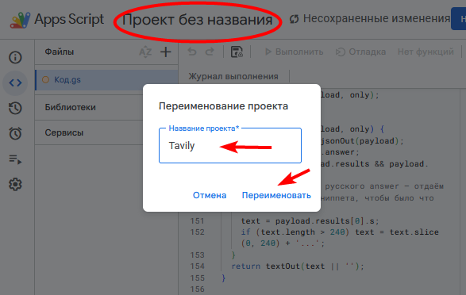

- Зайдите в "Настройки проекта":

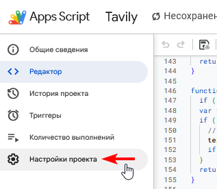

- Нажмите "Добавить свойство скрипта":

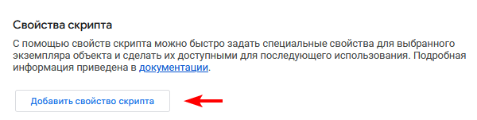

- "TAVILY_KEY" - ключ из личного кабинета "Tavily". "TOKEN" - придумайте длинную случайную последовательность символов и скопируйте, понадобится далее. После - "Сохранить свойства скрипта":

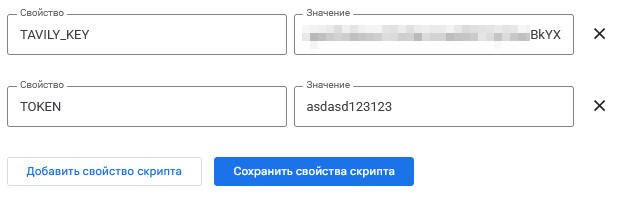

- Нажмите «Начать развёртывание» - "Новое развёртывание":

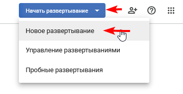

- Шестеренка - "Веб приложение":

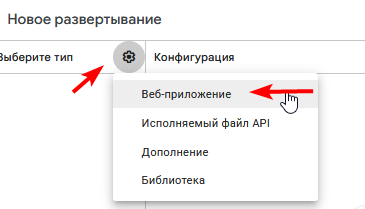

- "Запуск от имени" - "От моего имени". "У кого есть доступ" - "Все" (cкрипт будет выполняться от имени вашего Google-аккаунта. Защита запросов осуществляется с помощью TOKEN). "Начать равертывание":

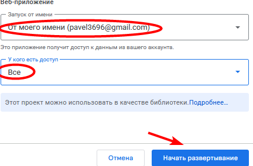

- Далее нужно предоставить доступ. Браузер может ругаться, переходим и даём права:

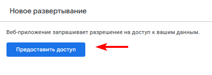

- Скопируйте идентификатор развёртывания веб-приложения:

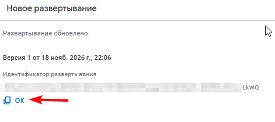

- Откройте веб-панель, в настройках системы укажите идентификатор и токен (который указали в свойствах скрипта):

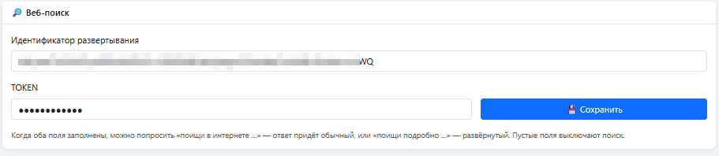

### Готово!

Настройка завершена. Теперь голосовой ассистент может выполнять поиск в интернете.